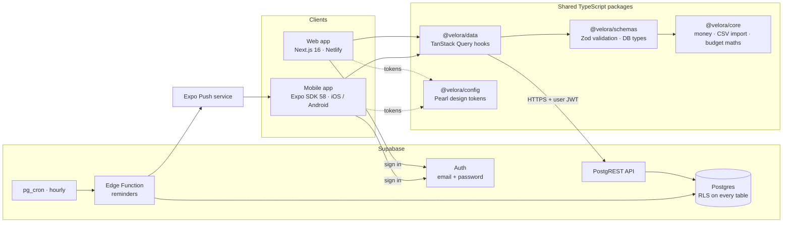
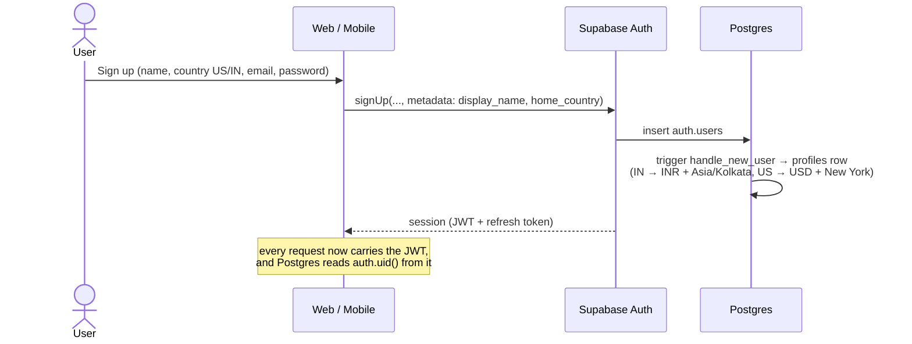
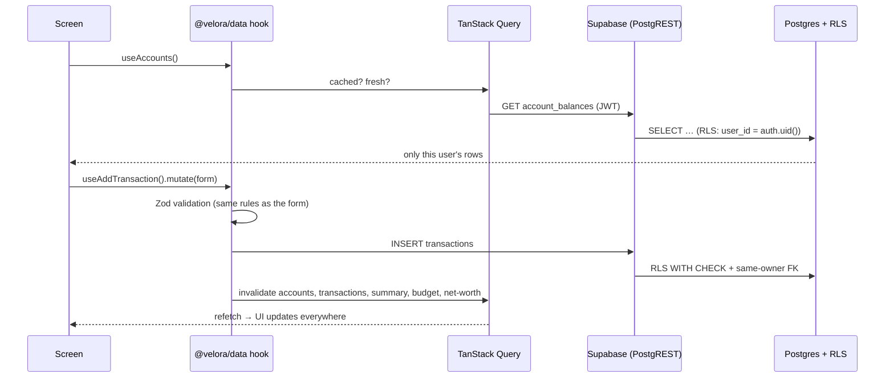
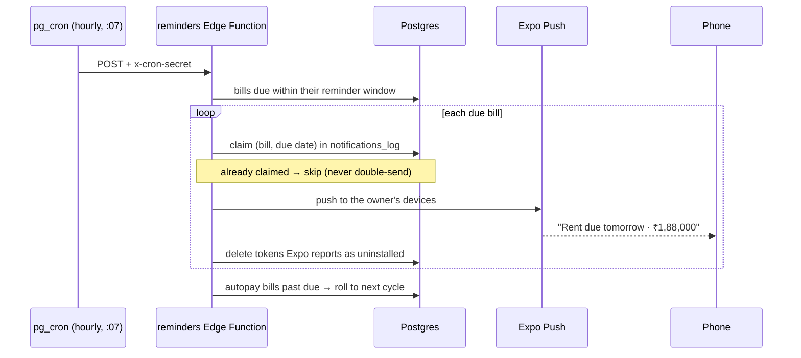

# How Velora works (as built)

This document describes the system **as it exists in the code today**. The longer-term target (bank sync, investments, FX, Storage) lives in [`ARCHITECTURE.md`](ARCHITECTURE.md); the visual system in [`design/DESIGN.md`](design/DESIGN.md).

## 1. The big picture

Velora is three things that share one brain:



- **No custom API server.** Both apps talk to Supabase directly with the signed-in user's token. Postgres **Row Level Security (RLS)** is what stops one user reading another's data — not the app code.
- **Business logic lives once**, in the shared packages, and both apps import it.
- **The only server-side code** is one scheduled Edge Function (bill reminders), because it needs the admin key and must run without a user present.

## 2. Repository map

```
apps/web/                      Next.js web app
  src/proxy.ts                   session refresh + sign-in redirect (Next 16's "middleware")
  src/app/(auth)/                /login, /signup
  src/app/auth/callback/         email-confirmation landing (code → session cookie)
  src/app/(app)/                 /, /flow, /activity, /budgets, /goals, /bills, /accounts
  src/components/                charts, orb, rings, nav, shadcn-style ui/
apps/mobile/                   Expo app
  src/app/_layout.tsx            fonts, session, auth guard, providers
  src/app/sign-in|sign-up.tsx    auth screens
  src/app/(tabs)/                Home, Budgets, Goals, Bills (+ floating Dock)
  src/app/add.tsx                quick-add keypad sheet
  src/app/account-new.tsx        new-account sheet
  src/lib/supabase.ts            client with Keychain/Keystore session storage
  src/lib/push.ts                push permission, token registration, sign-out unlink
packages/config|core|schemas|data
supabase/
  migrations/                    schema, RLS, reports, cron
  functions/reminders/           hourly push reminders
  tests/                         RLS + report tests (run in CI on plain Postgres)
.github/workflows/ci.yml       typecheck, lint, tests, web build, mobile bundle, DB tests
```

## 3. Money: one rule everywhere

Every amount is an **integer number of minor units** (cents or paise) plus a currency code — never a decimal float.

| Step | Where | Example |
|---|---|---|
| User types `1,250.50` | form field | text |
| Parse | `parseToMinor` (`@velora/core`) | `125050` |
| Validate | `amountInput` (`@velora/schemas`) | must be > 0 |
| Store | `transactions.amount bigint` | `-125050` (spend is negative) |
| Display | `formatMoney(…, 'INR')` | `-₹1,250` (en-IN lakh grouping) |

- **Sign convention:** money out is negative, money in positive. Credit-card and loan opening balances are stored negative (you owe them).
- **Formats:** `en-US` for USD (`$284,512.60`), `en-IN` for INR (`₹24,85,300`); compact forms `₹14.2 L`, `₹2.5 Cr`, `$1.2M`.

## 4. Sign-in and sessions



- **Web:** the session lives in cookies (`@supabase/ssr`). `src/proxy.ts` runs before every page, refreshes the cookie and verifies the JWT with `getClaims()`; signed-out visitors go to `/login`, signed-in users skip `/login`.
- **Mobile:** the session is stored in the iOS Keychain / Android Keystore via `expo-secure-store`. Sessions exceed the store's ~2 KB limit, so `lib/supabase.ts` splits them into chunks. Token refresh only runs while the app is in the foreground. The root layout uses `Stack.Protected`: signed out → sign-in screen; signed in → tabs.
- **Email confirmation** (when enabled in Supabase) returns to `/auth/callback` on web, or `velora://` on mobile.
- **Signing out** clears the TanStack Query cache (no previous user's data on screen) and, on mobile, first removes the device's push token.

## 5. How data moves (read and write)

Both apps wrap themselves in `VeloraDataProvider` (gives the hooks a Supabase client) and a TanStack Query client (caching, 30-second freshness, one retry).



| Hook | Reads / writes | Used by |
|---|---|---|
| `useProfile`, `useCurrency` | `profiles` | both |
| `useAccounts`, `useAddAccount` | `account_balances` view, `accounts` | both |
| `useTransactions`, `useAddTransaction`, `useDeleteTransaction` | `transactions` (+ category, account) | both / web |
| `useImportTransactions` | upsert `transactions` | web |
| `useMonthSummary` | RPC `month_summary` | both |
| `useBudget`, `useSetBudgetLine` | RPC `budget_progress`, `budget_lines` | both / web |
| `useNetWorth` | RPC `net_worth_history` | both |
| `useGoals`, `useAddGoal`, `useContribute` | `goals`, RPC `contribute_to_goal` | both / web |
| `useBills`, `useAddBill`, `useMarkBillPaid` | `recurring_items`, RPC `mark_bill_paid` | both / web |
| `useSavePushToken` | `push_tokens` | mobile |

Any write that can move money refreshes every money-related query, so balances, budgets, charts and summaries never disagree.

## 6. The database

**Tables** (all with `user_id`, all RLS-protected):

| Table | Holds | Notable rules |
|---|---|---|
| `profiles` | name, home country, base currency, timezone | created by sign-up trigger; read/update own only |
| `accounts` | bank/card/cash/investment accounts, opening balance | last-4 `mask` must be digits |
| `categories` | 13 built-in (shared, read-only) + user's own | built-ins can't be edited |
| `transactions` | signed amount, date, description, merchant, category, source | `(account_id, user_id)` FK = can only post to your own account; `UNIQUE(account_id, external_id)` = no duplicate imports; category must be visible to you |
| `budget_lines` | monthly limit per category | one per (user, month, category) |
| `goals` | target, saved so far, date | |
| `recurring_items` | bills: amount, cadence, next due, reminder days, autopay | |
| `push_tokens` | device push tokens | |
| `notifications_log` | which reminders were sent | no client access at all |

**Reports** run inside Postgres with `security invoker`, so RLS still applies:

- `account_balances` (view) — opening balance + sum of transactions.
- `month_summary(month)` — totals per category for a month.
- `budget_progress(month)` — budgeted vs spent per category.
- `net_worth_history(months)` — net worth at each month end.
- `contribute_to_goal(goal, amount)` and `mark_bill_paid(bill)` — atomic updates, so two taps can't lose an update.

> Reports currently count only accounts in the user's base currency. Mixed USD + INR needs the FX step in the target architecture.

## 7. Feature by feature

**Accounts.** Added with today's balance (web: Accounts page; mobile: "+ Add" on Home). Balances are always computed, never stored, so they can't drift.

**Transactions.** Added from the web dialog or the mobile keypad sheet (gold "+" in the dock). Expense/income toggle decides the sign.

**CSV statement import (web).**
1. Read the file in the browser; `parseCsv` handles quotes and Windows line endings.
2. `importStatement` finds the columns by name — `Date`, `Description/Narration/Particulars`, and either one signed `Amount` or `Debit/Withdrawal` + `Credit/Deposit` (the Indian bank layout).
3. Dates are read day-first for Indian users, month-first for US users.
4. Each row gets a stable fingerprint (`external_id`) from date + description + amount; two identical rows on one day get `_2`, `_3`.
5. `merchantFromNarration` turns `UPI/…/SWIGGY/swiggy@icici` into `Swiggy`.
6. Upsert with "ignore duplicates" → re-importing the same statement adds nothing; the dialog reports inserted vs already-existing rows.

**Budgets.** Monthly limit per category; progress turns gold at 85% and red when over.

**Safe to spend today** = (budget left this month − manual bills still due this month) ÷ days left including today, never below zero.

**Goals.** Contributions go through `contribute_to_goal`; the liquid-gold orb fills to the saved percentage.

**Bills and reminders.**



A phone receives reminders after the user taps **Turn on reminders** on the Bills tab (permission prompt → Expo token → `push_tokens`). If sending fails, the claim is released so the next hourly run retries.

**Insights ("Velora noticed", web Flow page).** Simple rules over your own data: budgets near or over limit, the category leading your spending, bills due within three days.

## 8. How the screens are built

**Web.** Pages are client components inside a Suspense boundary: the page shell is pre-built at deploy time and the data loads in the browser through the shared hooks. Components follow shadcn/ui conventions (`components/ui`, `cva`, Radix primitives). Charts: Recharts (net worth area, cash-flow Sankey).

**Mobile.** Expo Router screens styled with NativeWind (Tailwind classes). Navigation is a custom floating **Dock**: a glass pill whose active tab expands with its label, plus a gold quick-add button. Glass surfaces use Apple's Liquid Glass on iOS 26+, blur on older iPhones and a solid frosted fill on Android. Chart: Victory Native (Skia). Animations: Reanimated, respecting the OS "reduce motion" setting.

**Design tokens and dark mode.** `packages/config/src/tokens.json` holds two colour sets: Pearl (light) and Noir (dark). Web emits both as CSS variables, with Noir inside a `prefers-color-scheme: dark` media query, so the browser switches with no flash. Mobile sets the same variables at the app root with NativeWind's `vars()`, picking the set from the phone's appearance (`userInterfaceStyle: automatic`); a `useTheme()` hook supplies colours to the few places classes can't reach (blur tint, SVG strokes, placeholders).

## 9. Security model in one list

- RLS on every table; tested in CI (cross-user reads and writes, spoofed `user_id`, foreign categories, duplicate imports, anonymous access).
- Clients only ever hold the **publishable** key; the service-role key exists only inside the Edge Function.
- The reminders endpoint rejects calls without the cron secret.
- Web routing decisions use a **verified** JWT (`getClaims`), never an unverified cookie.
- Mobile sessions are in the Keychain / Keystore, not plain storage.
- Validation runs at every trust boundary: forms (Zod), hooks (Zod again before sending), and database constraints (lengths, signs, formats).
- Sentry is only initialised when a DSN is configured.

## 10. How it's verified

| Check | What it proves | Where |
|---|---|---|
| `pnpm test` (17 tests) | money parsing/formatting, CSV import, merchants, budgets, form validation | `packages/*/src/*.test.ts` |
| `supabase/tests/rls.test.sql` | isolation between users, reports' numbers | CI `database` job |
| `pnpm typecheck` / `pnpm lint` | all 6 workspace projects | CI |
| `next build` | web compiles and prerenders | CI |
| `expo export` (iOS + Android) | mobile bundles with every native module | CI |

## 11. Configuration

| Variable | App | Purpose |
|---|---|---|
| `NEXT_PUBLIC_SUPABASE_URL`, `NEXT_PUBLIC_SUPABASE_PUBLISHABLE_KEY` | web | API endpoint + public key |
| `EXPO_PUBLIC_SUPABASE_URL`, `EXPO_PUBLIC_SUPABASE_PUBLISHABLE_KEY` | mobile | same |
| `NEXT_PUBLIC_SENTRY_DSN`, `EXPO_PUBLIC_SENTRY_DSN` | both | optional error tracking |
| `CRON_SECRET`, `EXPO_ACCESS_TOKEN` | reminders function | cron auth; optional Expo push auth |
| Vault: `project_url`, `cron_secret` | database | used by the hourly cron call |

Setup and deploy steps: [`README.md`](../README.md).

## 12. Built vs. planned

| Area | Today | Target (see ARCHITECTURE.md) |
|---|---|---|
| Bank data | manual entry + CSV import | Plaid (US); Account Aggregator via a regulated partner (India) |
| Currencies | one base currency per user | FX conversion across USD/INR accounts |
| Investments | investment accounts as balances | holdings, prices, CAS import for Indian mutual funds |
| Sign-in | email + password | Google, Apple, phone OTP (India), MFA |
| Files | — | receipts and statements in Supabase Storage |
| Mobile editing | add transactions/accounts, contribute to goals | also create budgets, goals, bills |
| Account management | add | edit, archive, delete; data export; account deletion |
