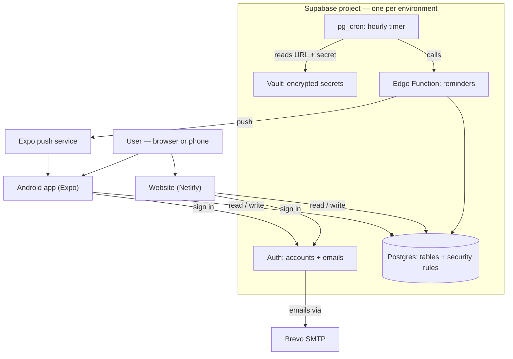
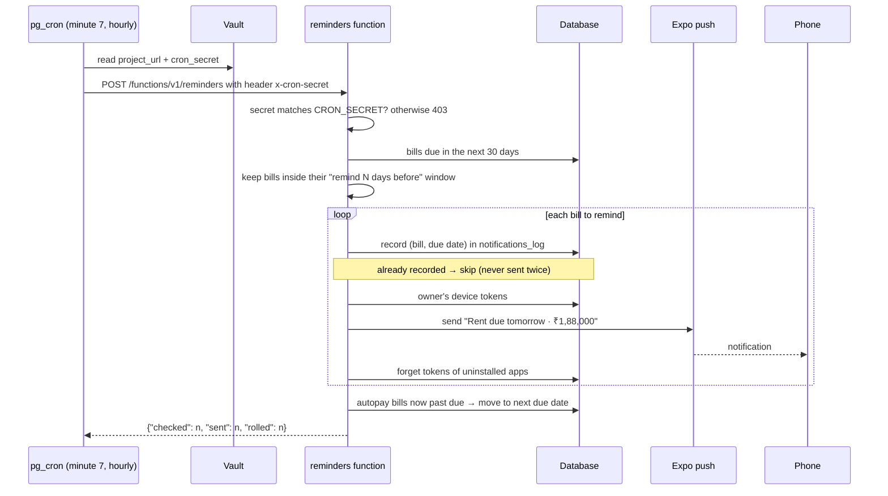

# Setup guide (browser only)

Everything here is done in a web browser — no installs. Do it **twice**: once for the **staging** Supabase project (`velora-staging`) and once for **production** (`velora`).
For the command-line route and app-store steps, see [`GO-LIVE.md`](GO-LIVE.md). For how the app itself works, see [`HOW-IT-WORKS.md`](HOW-IT-WORKS.md).

## What you're setting up



| Environment | Git branch | Supabase project | Website |
|---|---|---|---|
| Staging (testing) | `staging` | `velora-staging` | `staging--<site>.netlify.app` |
| Production (real users) | `main` | `velora` | `<site>.netlify.app` |

> Before every Supabase step, check the **project switcher at the top of the dashboard** shows the project you mean. Doing a step on the wrong project is the most common mistake.

---

## Step 1 — GitHub (once)

`main` and `staging` already exist. In the repo → **Settings**:

1. **General → Default branch** → `main`.
2. **General → Pull Requests** → allow only **Squash merging** (each change lands as one commit by whoever merges it).
3. **Branches → Add rule** for `main` and for `staging` → require a pull request and the **CI** checks before merging.

## Step 2 — Supabase project (per environment)

You need the project's **ID** (also called *ref*): the part of the dashboard address after `/project/`, or of the Project URL before `.supabase.co` — about 20 lowercase letters. Below it's written `<project-ref>`; replace the whole placeholder including `<` `>`.

### 2a. Create the database
1. On GitHub open `supabase/migrations/20261030000000_init.sql` → **Raw** → copy everything.
2. Supabase → **SQL Editor** → New query → paste → **Run** → "Success".
3. Same for `supabase/migrations/20261030000100_reminders_cron.sql`.

**What this does**
- The first file creates every table (profiles, accounts, categories, transactions, budgets, goals, bills, push tokens, reminder log), the 13 built-in categories, the **security rules** that keep each user's data private, the sign-up trigger that creates a profile (USD/INR by country), and the report functions (net worth, monthly summary, budget progress).
- The second file switches on two database extensions — **pg_cron** (a timer) and **pg_net** (lets the database make web requests) — and schedules a job named `velora-reminders` to run at minute 7 of every hour.

### 2b. Make a reminder secret
SQL Editor → new query:
```sql
select encode(extensions.gen_random_bytes(32), 'hex');
```
Copy the 64-character result — your **cron secret**. Make a **new one for each project**.

**What this does:** the reminder function is reachable from the internet, so it only obeys calls that carry this secret. Without it, anyone could trigger reminder emails/pushes.

### 2c. Store two secrets in the Vault
```sql
select vault.create_secret('https://<project-ref>.supabase.co', 'project_url');
select vault.create_secret('<cron-secret>', 'cron_secret');
```
**What this does:** the hourly job needs to know *where* the function lives and *what secret* to send. The Vault keeps both encrypted inside the database, so they never appear in code or on GitHub.

### 2d. Deploy the reminders function
1. On GitHub open `supabase/functions/reminders/index.ts` → **Raw** → copy.
2. Supabase → **Edge Functions → Deploy a new function → Via Editor** → name it exactly **`reminders`** → paste → **Deploy**.
3. In the function's details/settings, turn **off** "Verify JWT" (a.k.a. "Enforce JWT verification").
4. **Edge Functions → Secrets** → add `CRON_SECRET` = the same value as in 2c.

**What this does:** the function is the code that actually sends reminders (explained below). "Verify JWT" is turned off because the caller is the hourly timer, not a signed-in user — the cron secret replaces the user login check.

### 2e. Check it
SQL Editor:
```sql
select (select count(*) from public.categories) as categories,
       (select count(*) from cron.job where jobname = 'velora-reminders') as reminder_jobs,
       (select count(*) from vault.secrets where name in ('project_url','cron_secret')) as secrets;
```
Expect **13 · 1 · 2**. Then trigger one run by hand — exactly what the timer does every hour:
```sql
select net.http_post(
  url := (select decrypted_secret from vault.decrypted_secrets where name = 'project_url') || '/functions/v1/reminders',
  headers := jsonb_build_object('Content-Type', 'application/json',
             'x-cron-secret', (select decrypted_secret from vault.decrypted_secrets where name = 'cron_secret')),
  body := '{}'::jsonb
);
```
Wait ~5 seconds:
```sql
select status_code, content::text from net._http_response order by created desc limit 1;
```
Expect **200** and `{"checked":0,"sent":0,"rolled":0}`.

| Result | Meaning | Fix |
|---|---|---|
| `403` | Secrets don't match | Re-paste `CRON_SECRET` in Edge Functions → Secrets so it equals the Vault value exactly (no spaces) |
| `401` | JWT check still on | Turn off "Verify JWT" on `reminders` |
| `404` | Wrong function name/URL | Name must be exactly `reminders`; `project_url` must be `https://<project-ref>.supabase.co` |
| `500` | Function error | Edge Functions → `reminders` → **Logs** shows the message |
| no row | Request still running | Wait a few seconds and query again |

---

## How the reminder call works



- **Where phones come from:** a phone receives reminders only after its owner taps **Turn on reminders** on the Bills tab of the Android app, which saves its push token.
- **If sending fails**, the log entry is removed so the next hourly run tries again.
- **The function runs with admin rights** (Supabase provides that key to it automatically); it is the only part of Velora that does. Everything the apps do runs as the signed-in user, limited by the security rules.

## Step 3 — Website on Netlify (once)

1. Netlify → **Add new site → Import from GitHub** → `velora-finance`.
2. **Base directory** empty · **Package directory** `apps/web` · **Production branch** `main`.
3. **Environment variables** — add both, with a different value per deploy context:

   | Variable | Production (`main`) | Branch deploys (`staging`) |
   |---|---|---|
   | `NEXT_PUBLIC_SUPABASE_URL` | `https://<velora-ref>.supabase.co` | `https://<velora-staging-ref>.supabase.co` |
   | `NEXT_PUBLIC_SUPABASE_PUBLISHABLE_KEY` | velora's **publishable** key | velora-staging's **publishable** key |

   The values are in each Supabase project → **Project Settings → API Keys** (or the **Connect** button).
4. **Deploy.** Then Site configuration → Build & deploy → **Branches and deploy contexts → Branch deploys: Let me add individual branches** → `staging`.

**What this does:** Netlify builds the website from GitHub automatically on every merge — `main` becomes the live site, `staging` the test site — and each talks only to its own database.

## Step 4 — Sign-in settings (per project)

1. **Authentication → URL Configuration**
   - Site URL: that environment's website (production → `https://<site>.netlify.app`, staging → `https://staging--<site>.netlify.app`).
   - Redirect URLs: add `https://<that site>/auth/callback` and `velora://**`.
2. **Email sending (Brevo, free):** in Brevo create an **SMTP key**; in Supabase → **Authentication → Emails → SMTP Settings** enter Brevo's host, port, login and that key, and your verified sender address.

**What this does:** confirmation and password-reset emails reach real people (Supabase's built-in sender only mails your own team), and the links in them open your site, which finishes the sign-in at `/auth/callback`.

## Step 5 — Smoke test (staging first, then production)

On the website: sign up → confirm email → add an account → add a transaction → import a bank CSV → set a budget → create a goal and contribute → add a bill. Switch your device to dark mode and back. Check the **Flow** page shows your money moving.

## Step 6 — Android app (later)

Needs a terminal: use **GitHub → Code → Codespaces → Create codespace on main** (free monthly hours, runs in the browser). Then follow [`GO-LIVE.md` §3](GO-LIVE.md#3-mobile-apps-expo-eas) with the `preview` profile for staging and `production` for live.

---

## Where every key lives

| Secret | Where it is kept | Share it? |
|---|---|---|
| Database password | Your password manager | Never |
| **Publishable** key (`sb_publishable_…`) | Netlify / Expo environment variables | Safe — built for browsers and apps |
| **Secret / service-role** key | Only inside Supabase (the function gets it automatically) | Never — don't paste it anywhere |
| Cron secret | Vault (`cron_secret`) **and** Edge Function secret `CRON_SECRET` — same value | Never |
| Brevo SMTP key | Supabase SMTP settings only | Never |

## Day-to-day after setup

1. A change goes into a pull request → **`staging`**; CI must pass → merge → the staging site updates.
2. Try it on the staging site.
3. Pull request **`staging` → `main`** → merge → the live site updates.
4. **Database changes** come as new files in `supabase/migrations/`: run them in the SQL Editor on **velora-staging** first, test, then on **velora**.
5. If a free project pauses after a quiet week: Supabase dashboard → **Restore**. Data is kept.

> These migrations were applied through the SQL Editor, so the Supabase command-line tool doesn't know about them. If you start using it later, first run `npx supabase migration repair --status applied 20261030000000 20261030000100` once per project.
