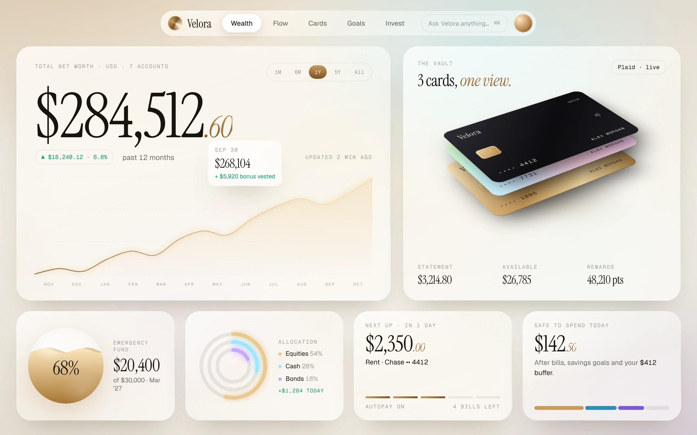
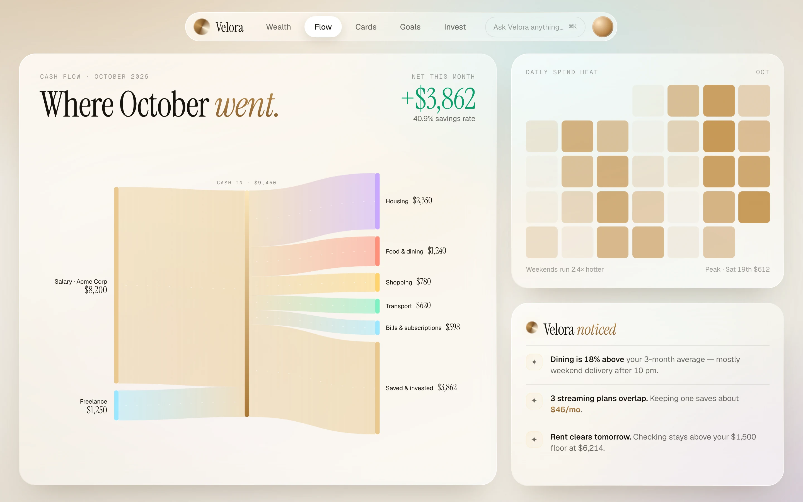
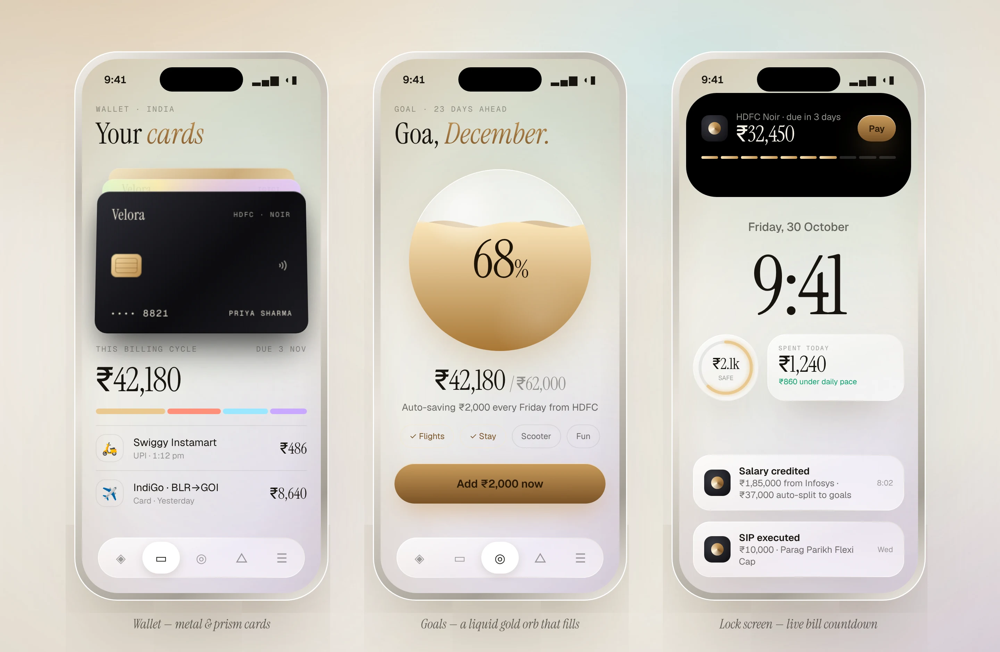
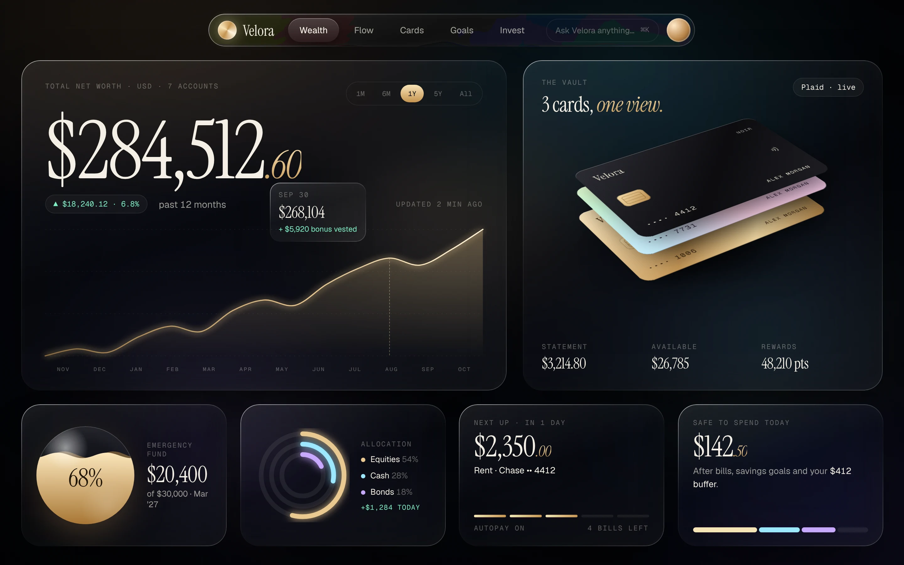
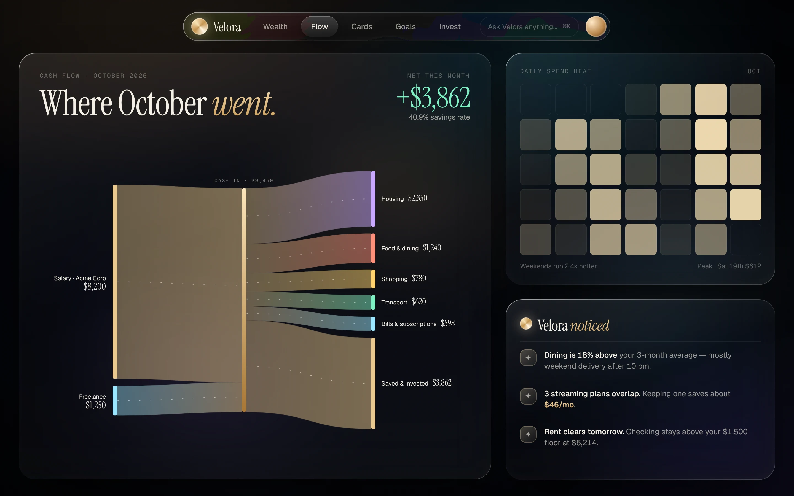
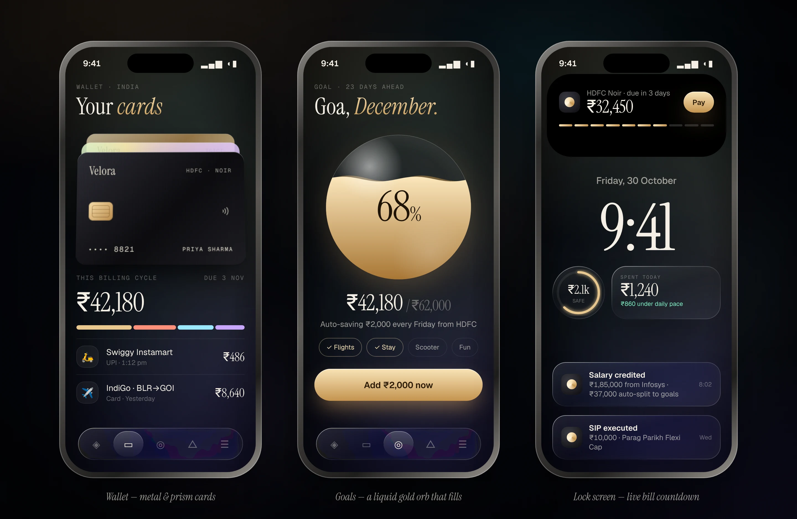

# Velora Design System — "Pearl" (light) / "Noir" (dark)

Private-bank feel: warm pearl surfaces, champagne-gold accents, editorial serif numerals, liquid-glass panels, and calm, physical motion.
**The app ships Pearl only** (chosen 30 Oct 2026). Noir is kept below as an explored dark variant; tokens for it are not implemented.

Live reference: open [`mockup.html`](./mockup.html) in Chrome — `?view=wealth|flow|mobile` and `&theme=pearl|noir`.

| Web · Wealth | Web · Flow |
|---|---|
|  |  |

Noir (dark mode)

## 1. Tokens

Defined once in `packages/config` (Tailwind preset) and consumed by Tailwind (web) and NativeWind (mobile).

| Token | Pearl | Noir | Use |
|---|---|---|---|
| `ink` | `#F2EEE6` | `#05060A` | App background |
| `text` | `#17140F` | `#F4EFE4` | Primary text |
| `muted` | text @ 62% | text @ 62% | Secondary text |
| `faint` | text @ 40% | text @ 36% | Labels, captions |
| `line` | `rgba(23,20,15,.08)` | `rgba(255,255,255,.07)` | Dividers, outlines |
| `gold-1` / `gold-2` | `#C99B5B` / `#7A5226` | `#F8E3B6` / `#C4934F` | Accent gradient (top → bottom) |
| `positive` | `#0F9E6E` | `#7EF0C3` | Gains, income |
| `negative` | `#D7553D` | `#FF8F7A` | Losses, overspend |
| `data-1..4` | gold, `#2A8FB8`, `#7D5BD6`, `#D7553D` | gold, `#9BE7FF`, `#C9A7FF`, `#FF8F7A` | Chart series |

Radii: panels `30`, cards `18`, pills `999`. Spacing on a 4-pt grid.

## 2. Typography

| Role | Font | Notes |
|---|---|---|
| Money & headlines | **Instrument Serif** | Large numerals (48–128 px); cents/paise set smaller in *italic gold* |
| UI text | **Geist** | 13–16 px, weights 400–600 |
| Labels & metadata | **Geist Mono** | 11 px, uppercase, `letter-spacing: .14em`, `faint` |

Fonts load via `next/font/google` (web) and `expo-font` (mobile). All figures use tabular numbers.

## 3. Money formatting

Amounts are integer minor units + ISO currency. Format with `Intl.NumberFormat`:
`en-US` for USD (`$284,512.60`), `en-IN` for INR (`₹24,85,300` — lakh grouping). Compact forms: `₹14.2 L`, `₹2.1k`, `$1.2M`.
Helper lives in `@velora/core`.

## 4. Liquid glass

| Layer | Web (Tailwind / CSS) | Mobile (Expo) |
|---|---|---|
| Frost | `backdrop-blur-[24px] backdrop-saturate-[1.7]` | `expo-blur` `<BlurView intensity={40} tint="light|dark">` |
| Body | 160° white gradient: Pearl 78%→42%→60%, Noir 9%→1.5%→4.5% | Same gradient via `expo-linear-gradient` over the blur |
| Specular rim | 1 px gradient border (masked pseudo-element) | 1 px border, `rgba(255,255,255,.5)` top / `.1` bottom |
| Depth | `0 40px 80px -30px` shadow + 1 px inner top highlight | `shadow*` props (iOS), `elevation` (Android) |
| Refraction (nav/dock only) | SVG `feDisplacementMap` via `backdrop-filter: url(#lens)` — Chromium + Noir only | Not used |

**Fallbacks:** Safari/Firefox get plain frost. **Android** — `BlurView` is costly: use the solid gradient body without blur on Android (or blur only the tab bar). Respect "Reduce transparency" (iOS) by switching to opaque surfaces.

## 5. Signature components

- **Net-worth hero** — serif count-up, gold line chart (smoothed), floating glass tooltip with pulsing beacon.
- **Card vault** — metal (black, gold) and holographic cards in a 3D stack, with slow hover and glare sweep. Mobile: stacked wallet with tilt.
- **Goal orb** — glass sphere filled with liquid gold whose surface sloshes (two waves, different speeds).
- **Allocation rings**, **segmented budget bar**, **"Safe to spend"** tile.
- **Cash-flow river** — Sankey (income → cash in → categories) with flowing particles.
- **Spend heat calendar** and **"Velora noticed"** insight list.
- **Live Activity / Dynamic Island** bill countdown and lock-screen widgets (iOS; Android uses ongoing notification).
- **Floating liquid dock** (mobile tabs) and **pill nav** with ⌘K "Ask Velora" (web).

Charts: Recharts (web) and Victory Native (mobile) styled with the tokens above; the Sankey is custom SVG (`react-native-svg` on mobile).

## 6. Motion

| Motion | Duration | Easing | Implementation (web / mobile) |
|---|---|---|---|
| Panel enter (fade + rise + de-blur, staggered 110 ms) | 1100 ms | `cubic-bezier(.16,1,.3,1)` | CSS / Framer Motion · Reanimated `FadeInDown` |
| Number count-up | 2200 ms | ease-out quint | rAF hook · Reanimated derived value |
| Chart line draw | 2600 ms | `cubic-bezier(.65,0,.35,1)` | stroke-dashoffset · `react-native-svg` animated props |
| Orb fill + slosh | 2400 ms fill, 5–8 s loop | ease-out / linear | CSS · Reanimated + SVG path |
| Card glare / hover | 5.5 s / 6 s loop | ease-in-out | CSS · Reanimated (pause when off-screen) |
| Live Activity morph | 1100 ms | spring (overshoot) | — · ActivityKit (native module) |
| Ambient light drift | 26 s loop | ease-in-out | CSS · disabled on mobile to save battery |

**Reduce motion** (OS setting): disable loops and count-ups; show final states instantly. Never animate money values the user is editing.

## 7. Accessibility

- Text contrast ≥ 4.5:1 on glass — verify against the *lightest* backdrop region; raise body opacity if it fails.
- Colour is never the only signal: gains/losses also carry ▲/▼ and +/−.
- Hit targets ≥ 44 pt; dock icons have labels for screen readers.
- Serif display sizes only for numbers/headlines; body copy stays in Geist ≥ 13 px.

## 8. Note on card art and brands

Card faces in the mockups are Velora-styled placeholders. Bank names appear only as text; do not reproduce real issuers' card artwork or logos without permission.
